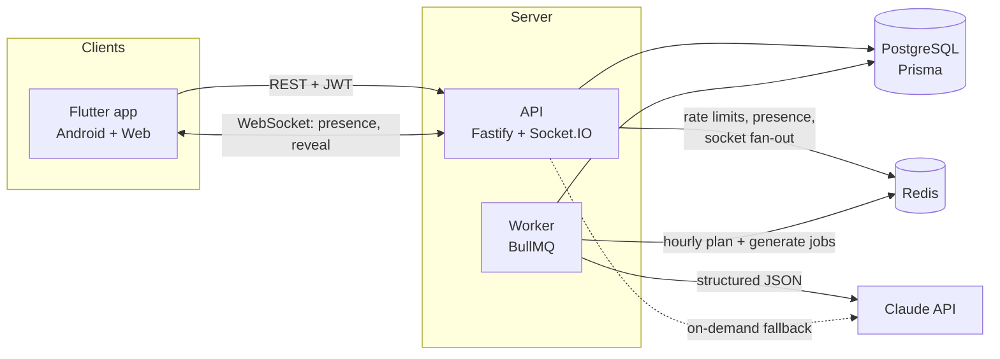

# Duo

A real-time daily game for two. Pair up with an invite code, get a short game every day that's
generated from both of your interests, and see your answers revealed side by side the moment you
both finish. Keep the streak alive.

> **Live:** _add the web URL here_ · **Android:** latest APK on [Releases](../../releases)
>
> _Add a screenshot or GIF of the live reveal here._

## Features

- **Three game types** on one engine: *Who knows whom better*, *Would you rather*, *Team trivia*
- **AI-personalised daily games** from both partners' interests, validated against a strict schema,
  pre-generated overnight, with a curated question bank as fallback
- **Live reveal and presence** over WebSockets: see when your partner is online or playing, and get
  results the instant they submit
- **Idempotent submissions**: a double tap, a retry after a timeout, or two devices can't create
  duplicate answers
- **Timezone-safe streaks**: a "day" is a calendar day in the pair's timezone
- Email/password and Google sign-in, rotating refresh tokens, Redis rate limiting
- History of past games, analytics events, Sentry on app, API and worker

## Architecture



| Path | What |
|---|---|
| `server/src/modules/auth` | Register, login, Google, refresh rotation, logout |
| `server/src/modules/pairing` | Invite codes, join, unpair, partner card |
| `server/src/modules/games` | Content schema, question bank, game service (view, submit, scoring, history) |
| `server/src/modules/realtime` | Socket.IO: auth, pair rooms, presence, reveal, catch-up |
| `server/src/modules/ai` | LLM client, prompt, validation, cache, cost logging |
| `server/src/jobs` | Pre-generation planner and worker |
| `app/lib/core` | API client (token refresh), socket client, models |
| `app/lib/features` | Screens + Riverpod controllers per feature |

### A day in the life of a game

1. Every hour the worker plans which pairs need today's or tomorrow's game (in *their* timezone)
   and enqueues one job per pair and day. Job IDs deduplicate.
2. The job asks Claude for a game using structured outputs, then validates it against the same
   schema the bank uses: option counts, a correct answer for trivia, questions about both partners
   for who-knows-whom. Attempts 1–2 throw on failure so BullMQ retries with backoff; attempt 3
   falls back to the bank. Every attempt is logged with latency, tokens and cost.
3. A player opens the app → `GET /games/today`. If the job hasn't run yet the API generates on
   demand with a shorter timeout, falling back to the bank.
4. The first player submits with an `Idempotency-Key`; their partner's socket gets
   `game:partner_submitted`.
5. The second submit flips `completed_at` with a conditional update, so exactly one request wins.
   That request records the streak and emits `game:revealed`, tailored to each player, to both
   phones.
6. A phone that was offline gets the full state in the `sync` event when it reconnects.

## Design decisions

- **Schema locked on day 1.** Every table (including generation logs and streaks) was in the first
  migration, so later features added behaviour without migrations.
- **One content shape for every game type and source.** The bank, the LLM, the API and the client
  all speak `{type, title, questions[{prompt, options, correctOption?, about?}]}`. Adding a game type
  is a schema rule, a prompt, and a results card.
- **Correctness through the database, not locks in code.** Race-prone transitions are single guarded
  updates: claiming an invite (`used_at IS NULL`), linking a pair (`current_pair_id IS NULL` on both
  users, must update 2 rows), completing a game (`completed_at IS NULL`), rotating a refresh token
  (`revoked_at IS NULL`). Tests run the concurrent cases.
- **Idempotency by key *and* by uniqueness.** The key replays the original response; the
  `(game_id, user_id)` unique constraint guarantees one submission even if a client sends a new key.
- **Answers are hidden server-side.** The partner's choices and trivia answers are never sent until
  the game is complete, so they can't be read from the network tab.
- **Days, not instants.** Games and streaks key on `YYYY-MM-DD` in the pair's timezone (the
  inviter's), so DST and UTC offsets can't break a streak.
- **Refresh tokens rotate with reuse detection.** Presenting an already-used refresh token revokes
  the whole session family.
- **The LLM is optional.** Without `ANTHROPIC_API_KEY` everything works from the bank, which keeps
  local dev, CI and outages simple.
- **Prompts treat user text as data.** Names and interests are JSON-quoted in the prompt, and every
  output is validated before anyone sees it.

## Running locally

Requirements: Node 22 (`nvm use`), Docker, Flutter 3.47+.

```bash
docker compose up -d                 # Postgres (dev + test DBs) and Redis
cd server
cp .env.example .env                 # add ANTHROPIC_API_KEY to enable AI games
npm install
npx prisma migrate dev
npm run dev                          # API on :3000
npm run dev:worker                   # in another terminal: pre-generation worker

cd ../app
flutter run -d chrome --dart-define=API_URL=http://localhost:3000
# Android emulator: --dart-define=API_URL=http://10.0.2.2:3000
```

Google sign-in needs OAuth client IDs: set `GOOGLE_CLIENT_IDS` (web and Android IDs, comma
separated) on the server and `--dart-define=GOOGLE_WEB_CLIENT_ID=…` in the app.

### Tests

```bash
cd server && npm test     # integration tests against a real Postgres/Redis (docker compose)
cd app && flutter test    # widget and unit tests
```

Server coverage includes auth (rotation, reuse detection), pairing (every invite error, concurrent
joins), rate limiting, the game flow for all three types, idempotent double-submits, sockets
(auth, presence, live reveal, reconnect catch-up, room moves), AI success, invalid output, refusals
and fallbacks, job retries, streak rules across DST and year boundaries, and paginated history.

### Metrics

```bash
cd server && npm run metrics          # last 14 days: funnel, daily games, AI success rate, latency, cost
```

## Deployment

- **API + worker:** one Docker image (`server/Dockerfile`), described by `render.yaml` with managed
  Postgres and Redis. Migrations run in the API's pre-deploy step.
- **Web:** Flutter web build on Firebase Hosting (`app/firebase.json`).
- **Android:** release APK attached to a GitHub Release.
- **CI/CD:** `ci.yml` lints and tests both projects on every push and PR. `deploy.yml` runs only
  after CI passes on `main` and triggers each deploy whose secrets are configured:

| Secret / variable | Used for |
|---|---|
| `RENDER_API_DEPLOY_HOOK`, `RENDER_WORKER_DEPLOY_HOOK` (secrets) | Backend deploys |
| `FIREBASE_SERVICE_ACCOUNT` (secret), `FIREBASE_PROJECT_ID` (variable) | Web deploy |
| `API_URL`, `GOOGLE_WEB_CLIENT_ID`, `APP_SENTRY_DSN` (variables) | App build config |

## What I'd improve next

- Push notifications ("your partner just played") to bring people back. This is the biggest lever
  for streaks.
- Play Store signing and an iOS build.
- Let the pair choose its timezone instead of inheriting the inviter's.
- Evaluate generated games: sample them for a human rating and track it next to the cost and
  failure rate.
- Use the Message Batches API for the nightly generation: it's 50% cheaper and nothing in that path
  is latency-sensitive.
- Stale presence cleanup if an API instance crashes (heartbeat TTLs instead of connection counts).
