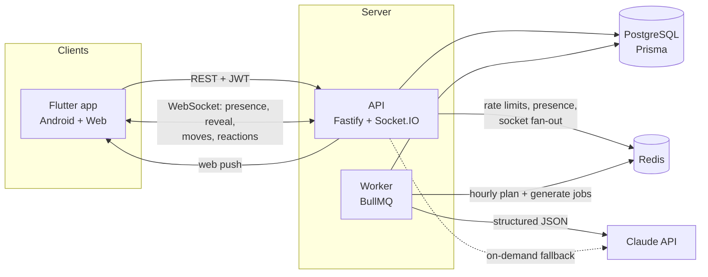

# Duo

A real-time daily game for any two people: partners, best friends, siblings, a parent and child,
colleagues, or whatever you call each other. Pair up with an invite code, get a short game every
day built from both of your interests, and see your answers revealed side by side the moment you
both finish. Then react, chat about it, challenge each other in the arcade, and keep the streak alive.

> **Live:** [dyduo.netlify.app](https://dyduo.netlify.app) · **API:** `duo-api-tumt.onrender.com` ·
> **Android:** latest APK on [Releases](../../releases)
>
> The free API host sleeps when idle, so the first request after a while can take ~50 seconds.

## Features

- **Six daily game types** on one engine: *Who knows whom better*, *Would you rather*, *Team
  trivia*, *Emoji decode*, *Agree-o-meter* and *Rank it*
- **Any relationship**: pick a preset (partners, best friends, siblings, parent & child,
  colleagues…) or type your own label. Prompts and copy adapt to it, e.g. no romantic questions
  between siblings
- **AI-personalised daily games** from both people's interests, validated against a strict schema,
  with a curated question bank as fallback
- **A shared pet** that hatches from an egg the first time you play together, then grows (baby →
  kid → grown-up) as you play daily games, arcade games and bonus rounds and give it a daily pat.
  It gets hungry, then sleepy, when you skip days, and unlocks outfits as it levels up
- **500+ hand-written questions** with no repeats: each pair only gets questions it hasn't seen,
  enough for three months of daily games. Every trivia and emoji answer comes with an explanation
  that also says why the tempting wrong options don't fit
- **Bonus rounds**: finished today's game? Start extra rounds of any type. They don't touch the streak
- **Live reveal and presence** over WebSockets: see when the other person is online or playing, and
  get the results the instant they submit
- **Reactions and chat on results**: react to each answer with an emoji and talk about it under the
  reveal, live on both screens
- **Push notifications** (web push): "they played", "the results are in", "your move", new
  messages. Skipped while you have Duo open
- **Two-player arcade**, server-authoritative and turn-based: tic-tac-toe, four in a row, dots and
  boxes, chess, ludo (the die rolls itself, both players see both dice) and Word Tiles (a crossword
  tile game checked against a 170k-word dictionary)
- **Idempotent submissions** and **versioned arcade moves**: double taps, retries and two devices
  can't create duplicates or play out of turn
- **Timezone-safe streaks**: a "day" is a calendar day in the pair's timezone
- **Play as a guest**: start with just a name, no email. Save the account later and keep the pair,
  streak and pet
- Email/password and Google sign-in, rotating refresh tokens, Redis rate limiting
- Sticker-book UI with light/dark themes and reduce-motion support; history, analytics events,
  Sentry on app, API and worker

## Architecture



| Path | What |
|---|---|
| `server/src/modules/auth` | Register, login, Google, refresh rotation, logout |
| `server/src/modules/pairing` | Invite codes, join, unpair, partner card |
| `server/src/modules/games` | Content schema, question bank, game service (view, submit, scoring, bonus rounds, reactions, chat, history) |
| `server/src/modules/arcade` | Turn-based matches; one pure engine per game (`engines/`), optimistic versioning |
| `server/src/modules/push` | Web push subscriptions, VAPID sender, triggers for game and match events |
| `server/src/modules/realtime` | Socket.IO: auth, pair rooms, presence, reveal, catch-up |
| `server/src/modules/ai` | LLM client, prompt, validation, cache, cost logging |
| `server/src/jobs` | Pre-generation planner and worker |
| `app/lib/core` | API client (token refresh), socket client, models, web push bridge |
| `app/lib/features` | Screens + Riverpod controllers per feature |

### A day in the life of a game

1. Every hour the worker plans which pairs need today's or tomorrow's game (in *their* timezone)
   and enqueues one job per pair and day. Job IDs deduplicate.
2. The job asks Claude for a game using structured outputs, then validates it against the same
   schema the bank uses: option counts, a correct answer for trivia, questions about both partners
   for who-knows-whom. Attempts 1–2 throw on failure so BullMQ retries with backoff; attempt 3
   falls back to the bank. Every attempt is logged with latency, tokens and cost.
3. A player opens the app → `GET /games/today`. If the job hasn't run yet the API generates on
   demand with a shorter timeout, falling back to the bank.
4. The first player submits with an `Idempotency-Key`; their partner's socket gets
   `game:partner_submitted`.
5. The second submit flips `completed_at` with a conditional update, so exactly one request wins.
   That request records the streak and emits `game:revealed`, tailored to each player, to both
   phones.
6. A phone that was offline gets the full state in the `sync` event when it reconnects.

## Design decisions

- **Schema locked on day 1.** Every table (including generation logs and streaks) was in the first
  migration, so later features added behaviour without migrations.
- **One content shape for every game type and source.** The bank, the LLM, the API and the client
  all speak `{type, title, questions[{prompt, options, correctOption?, about?}]}`. Adding a game type
  is a schema rule, a prompt, and a results card.
- **Correctness through the database, not locks in code.** Race-prone transitions are single guarded
  updates: claiming an invite (`used_at IS NULL`), linking a pair (`current_pair_id IS NULL` on both
  users, must update 2 rows), completing a game (`completed_at IS NULL`), rotating a refresh token
  (`revoked_at IS NULL`). Tests run the concurrent cases.
- **Idempotency by key *and* by uniqueness.** The key replays the original response; the
  `(game_id, user_id)` unique constraint guarantees one submission even if a client sends a new key.
- **Answers are hidden server-side.** The partner's choices and trivia answers are never sent until
  the game is complete, so they can't be read from the network tab.
- **Days, not instants.** Games and streaks key on `YYYY-MM-DD` in the pair's timezone (the
  inviter's), so DST and UTC offsets can't break a streak.
- **Refresh tokens rotate with reuse detection.** Presenting an already-used refresh token revokes
  the whole session family.
- **The LLM is optional.** Without `ANTHROPIC_API_KEY` everything works from the bank, which keeps
  local dev, CI and outages simple.
- **Arcade engines are pure functions.** Each game is `init / apply(move) / outcome / view(seat)`
  with a seeded RNG, so the server is the only referee, hidden information (like the other
  player's tiles) never leaves it, and every rule is unit-tested without a database.
- **The pet's XP is counted, not stored.** It's derived from completed games, finished matches
  and pats, so it can't drift out of sync or be double-counted by a retried request.
- **Push only when it helps.** A notification is skipped if that person has a live socket, and
  subscriptions the push service reports as gone (404/410) are deleted.
- **Prompts treat user text as data.** Names and interests are JSON-quoted in the prompt, and every
  output is validated before anyone sees it.

## Running locally

Requirements: Node 22 (`nvm use`), Docker, Flutter 3.47+.

```bash
docker compose up -d                 # Postgres (dev + test DBs) and Redis
cd server
cp .env.example .env                 # add ANTHROPIC_API_KEY to enable AI games, VAPID keys for push
npm install
npx prisma migrate dev
npm run dev                          # API on :3000
npm run dev:worker                   # in another terminal: pre-generation worker

cd ../app
flutter run -d chrome --dart-define=API_URL=http://localhost:3000
# Android emulator: --dart-define=API_URL=http://10.0.2.2:3000
```

Push notifications need a VAPID key pair: `npx web-push generate-vapid-keys`, then set
`VAPID_PUBLIC_KEY` and `VAPID_PRIVATE_KEY`. Without them push is simply off. Browsers only allow
push on `localhost` or HTTPS; on iPhone, Duo has to be added to the home screen first.

Google sign-in needs OAuth client IDs: set `GOOGLE_CLIENT_IDS` (web and Android IDs, comma
separated) on the server and `--dart-define=GOOGLE_WEB_CLIENT_ID=…` in the app.

### Tests

```bash
cd server && npm test     # integration tests against a real Postgres/Redis (docker compose)
cd app && flutter test    # widget and unit tests
```

Server coverage includes auth (rotation, reuse detection), pairing (every invite error, concurrent
joins), rate limiting, CORS preflight, the game flow for every type, bonus rounds, reactions and
chat, push triggers, every arcade engine, idempotent double-submits, sockets
(auth, presence, live reveal, reconnect catch-up, room moves), AI success, invalid output, refusals
and fallbacks, job retries, streak rules across DST and year boundaries, and paginated history.

### Metrics

```bash
cd server && npm run metrics          # last 14 days: funnel, daily games, AI success rate, latency, cost
```

## Deployment

The live version runs entirely on free tiers:

| Piece | Host | Notes |
|---|---|---|
| API (Docker) | Render free web service | `server/Dockerfile`; `npm run start:prod` runs migrations, then the server. Sleeps after 15 min idle |
| Postgres | Neon | `DATABASE_URL` |
| Redis | Upstash | `REDIS_URL` (`rediss://`) |
| Web app | Netlify | `flutter build web --release --dart-define=API_URL=https://<api>` and upload `app/build/web` |

Render environment variables: `DATABASE_URL`, `REDIS_URL`, `JWT_ACCESS_SECRET`, `NODE_ENV=production`,
`CORS_ORIGINS` (the Netlify URL), and optionally `ANTHROPIC_API_KEY` and
`VAPID_PUBLIC_KEY` / `VAPID_PRIVATE_KEY` / `VAPID_SUBJECT`.
On the free plan there is no background worker, so games are generated on demand when someone
opens the app.

`render.yaml` describes the paid setup instead (API + worker + managed Postgres and Redis).

- **Android:** release APK attached to a GitHub Release.
- **CI/CD:** `ci.yml` lints and tests both projects on every push and PR. `deploy.yml` runs only
  after CI passes on `main` and triggers each deploy whose secrets are configured:

| Secret / variable | Used for |
|---|---|
| `RENDER_API_DEPLOY_HOOK`, `RENDER_WORKER_DEPLOY_HOOK` (secrets) | Backend deploys |
| `NETLIFY_AUTH_TOKEN`, `NETLIFY_SITE_ID` (secrets) | Web deploy |
| `API_URL`, `GOOGLE_WEB_CLIENT_ID`, `APP_SENTRY_DSN` (variables) | App build config |

## What I'd improve next

- Native push on Android/iOS (Firebase Cloud Messaging); today push is web-only.
- Play Store signing and an iOS build.
- Keep the free API warm, or move to a paid instance, so the first load isn't slow.
- Let the pair choose its timezone instead of inheriting the inviter's.
- Evaluate generated games: sample them for a human rating and track it next to the cost and
  failure rate.
- Use the Message Batches API for the nightly generation: it's 50% cheaper and nothing in that path
  is latency-sensitive.
- Stale presence cleanup if an API instance crashes (heartbeat TTLs instead of connection counts).
